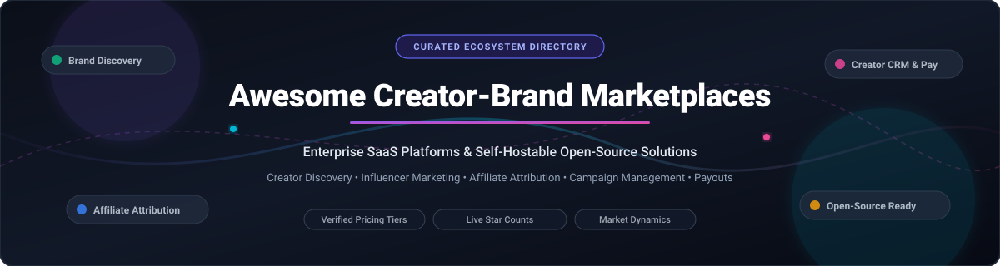

<p align="center">
  
</p>

<p align="center">
  <a href="https://github.com/ishandutta2007/Awesome-Awesome-Awesome"></a>
  <a href="https://discord.gg/jc4xtF58Ve"></a>
  <a href="https://github.com/ishandutta2007/Awesome-Awesome-Awesome"></a>
  <a href="https://github.com/ishandutta2007/Awesome-Creator-Brand-Marketplaces/stargazers"></a>
  <a href="https://github.com/ishandutta2007/Awesome-Creator-Brand-Marketplaces/network/members"></a>
  <a href="https://github.com/ishandutta2007/Awesome-Creator-Brand-Marketplaces/issues"></a>
  <a href="https://github.com/ishandutta2007/Awesome-Creator-Brand-Marketplaces/pulls"></a>
  <a href="LICENSE"></a>
  <a href="https://github.com/ishandutta2007"></a>
</p>

---

# 🌟 Awesome Creator-Brand Marketplaces

> 🚀 A curated list of **SaaS platforms**, **creator discovery engines**, **influencer marketing networks**, and **open-source software** powering the modern creator economy, brand collaborations, and affiliate attribution.

Welcome to the definitive directory of tools connecting the supply side of the creator economy (influencers, UGC creators, affiliate publishers, digital artists) with brand and agency demand. Whether you are an enterprise growth team seeking an all-in-one influencer CRM or a developer building self-hosted creator monetization infrastructure, this list tracks verified pricing, company scale, open-source repositories, and market dynamics. ✨

---

## 📑 Table of Contents

- [📊 Sector Overview & Market Dynamics](#-sector-overview--market-dynamics)
- [💼 SaaS & Hosted Platforms](#-saas--hosted-platforms)
- [💻 Open-Source GitHub Projects](#-open-source-github-projects)
- [🏗️ Open-Source Architecture Blueprint](#️-open-source-architecture-blueprint)
- [🤝 How to Contribute](#-how-to-contribute)
- [💖 Support & Community](#-support--community)
- [📈 Star History](#-star-history)
- [📜 Disclaimer & Compliance](#-disclaimer--compliance)

---

## 📊 Sector Overview & Market Dynamics

The global **influencer marketing platform market** is estimated at **$27.5 billion to $34.2 billion** (projected to reach **$45+ billion** by 2027 at a 15.2% CAGR), operating within the broader **$250 billion to $325+ billion creator economy** 📈. 

The sector is **moderately fragmented** rather than a winner-take-all monopoly: while enterprise market leaders like Impact.com, CreatorIQ, and GRIN capture top-tier direct-to-consumer (DTC) brands and global agencies, extreme channel diversification (TikTok Shop, Instagram Reels, YouTube Shorts, Substack, Twitch) and specialized use cases (UGC creator sourcing, affiliate tracking, gifting logistics, brand safety) support a vibrant ecosystem of mid-market SaaS platforms and self-hosted open-source software 🌐.

---

## 💼 SaaS & Hosted Platforms

The table below lists category-leading creator-brand marketplace platforms, sorted in descending order by **company size** (valuation / annual recurring revenue). Verified entry-level pricing tiers and exact free tier/trial limits are detailed to avoid opaque enterprise quotes 🏷️.

| 🏢 Platform | 💰 Company Size (Valuation / Revenue) | 🏷️ Starting Tier Pricing | 🎁 Free Tier / Trial Limits | 🎯 Core Focus & Capabilities |
| :--- | :--- | :--- | :--- | :--- |
| **[Impact.com](https://impact.com/)** | **$1.5 Billion** Valuation (~$270M ARR) | **$30/month** (Starter via Shopify) or **$500/month** (Essentials) | **30-day risk-free trial** on Starter plan (platform minimum fee waived); Free forever for creators/publishers to register and apply | 🤝 Enterprise partnership automation covering affiliates, creator collaborations, multi-touch attribution, contracted automated payouts, and cross-channel tracking. |
| **[GRIN](https://grin.co/)** | **$910 Million** Valuation (~$35M ARR) | **$200/month** (Starter self-serve plan) | **Free forever plan** ($0/month, 50 usage credits); **30-day free trial** on self-serve Starter plan with no mandatory sales demo | 🛍️ DTC creator management platform integrated with Shopify, BigCommerce, and WooCommerce for automated product gifting, affiliate links, and ROI analytics. |
| **[CreatorIQ](https://www.creatoriq.com/)** | **~$350M–$400M** Est. Valuation (~$70M ARR) | **$2,500/month** ($30,000/year minimum annual contract) | **No self-serve free tier**; sales-assisted pilot / proof-of-concept trial arranged after enterprise sales demo | 🔍 Enterprise influencer marketing cloud with creator discovery across 20M+ profiles, fraud detection, audience demographics, and campaign ROI tracking. |
| **[Aspire](https://www.aspireiq.com/)** | **~$150M–$200M** Est. Valuation (~$38M ARR) | **$2,000/month** ($24,000/year minimum annual contract) | **No self-serve free tier**; guided sandbox demo with sales-arranged pilot access; creator community membership is 100% free | 📣 End-to-end influencer marketing platform featuring creator marketplace inbound pitches, automated product seeding, content licensing, and affiliate sales tracking. |
| **[Captiv8](https://captiv8.io/)** | **$150 Million** (Acquired by Publicis Groupe; ~$28M ARR) | **$2,083/month** ($25,000/year billed annually) | **No free tier or public trial**; enterprise live sandbox walkthrough provided upon scheduling a product demo | 🧠 Enterprise creator intelligence and marketplace platform with social listening, audience authenticity scoring, paid media amplification, and shoppable storefronts. |
| **[Traackr](https://www.traackr.com/)** | **~$60M–$80M** Est. Valuation (~$22M ARR) | **$1,416/month** ($17,000/year billed annually) | **No public free tier**; 4-week sales-approved evaluation trial available upon qualified sales request | 🛡️ Data-driven influencer relationship management (IRM) system specializing in global brand safety, benchmark Brand Vitality Score (BVS), and creator payments. |
| **[#paid](https://hashtagpaid.com/)** | **~$50M–$70M** Est. Valuation (~$18M ARR) | **$449/month** ("Just Content" plan, billed monthly) | **No brand free tier**; personalized demo trial on request; 100% free forever for creators to pitch campaigns | ✋ Creator collaboration platform using "Handraise" bidding where vetted creators pitch creative concepts to brands; native creator whitelisting and ad boosting. |
| **[Upfluence](https://www.upfluence.com/)** | **~$30M–$50M** Est. Valuation (~$14M ARR) | **$478/month** (Modular search plan, billed annually) | **No self-serve free tier**; custom guided sandbox trial granted after completing initial sales demo call | 🔎 Influencer search engine and affiliate management system with Chrome extension for creator profiling, customer-to-advocate identification, and bulk outreach. |
| **[Collabstr](https://collabstr.com/)** | **~$6M–$10M** Est. Valuation (~$3M ARR) | **$0/month** (Basic) / **$249/month** (Pro, billed annually) | **Free forever plan** ($0/month) with creator search, direct-hiring, and messaging (subject to 10% marketplace hiring fee and 0 monthly inbound job postings) | 🛒 Self-serve public creator marketplace connecting brands with vetted TikTok, Instagram, and YouTube creators for rapid UGC purchasing and escrow payments. |
| **[Creator.co](https://creator.co/)** | **~$6.3M** Est. Valuation (~$4.2M ARR) | **$199/month** (Self-serve, billed annually) | **14-day free trial** with full platform search and workflow access (no credit card required upfront) | ⚡ Dual self-serve and managed creator marketplace focusing on automated micro-influencer collaboration, UGC generation, and social affiliate programs. |

---

## 💻 Open-Source GitHub Projects

Open-source tools offer self-hostable alternatives to commercial platforms for affiliate attribution, creator CRMs, referral tracking, and link management without recurring software license fees 🔓.

The repositories below are sorted in descending order by **GitHub_Stars_Count**. Click any badge to inspect stargazers and repository activity ⭐.

| 📦 Repository | ⭐ GitHub_Stars | 📄 License | 🛠️ Primary Tech Stack | 💡 Description & Use Case |
| :--- | :--- | :--- | :--- | :--- |
| **[Twenty](https://github.com/twentyhq/twenty)** | [](https://github.com/twentyhq/twenty/stargazers) | AGPL-3.0 | TypeScript, NestJS, React, PostgreSQL | 👥 Modern open-source CRM platform ideal for managing brand-creator relationships, sponsorship deal pipelines, influencer talent rosters, and custom collaboration workflows. |
| **[Dub.co](https://github.com/dubinc/dub)** | [](https://github.com/dubinc/dub/stargazers) | AGPL-3.0 | Next.js, TypeScript, Tailwind, Upstash, Prisma | 🔗 Open-source link management and conversion attribution platform. Provides branded short links, geo-targeting, creator referral tracking, and real-time click analytics. |
| **[Gumroad](https://github.com/antiwork/gumroad)** | [](https://github.com/antiwork/gumroad/stargazers) | Source Available | Ruby on Rails, React, PostgreSQL | 🪙 Landmark open-source creator commerce platform that has paid out over $1B to creators. Provides self-hosted digital product storefronts, creator memberships, and 0% marketplace fee infrastructure. |
| **[Crater](https://github.com/crater-invoice/crater)** | [](https://github.com/crater-invoice/crater/stargazers) | GPL-3.0 | PHP, Laravel, Vue.js, MySQL | 🧾 Open-source invoicing and payment suite tailored for freelance creators, agencies, and brand campaign disbursements with multi-currency and payment gateway support. |
| **[Sharetribe](https://github.com/sharetribe/sharetribe)** | [](https://github.com/sharetribe/sharetribe/stargazers) | Apache-2.0 | Ruby on Rails, React | 🏪 Production marketplace software designed to build two-sided creator-brand booking, custom commission marketplaces, and collaboration directories. |
| **[RefRef](https://github.com/amicalhq/refref)** | [](https://github.com/amicalhq/refref/stargazers) | AGPL-3.0 | TypeScript, Next.js, PostgreSQL, Drizzle, BullMQ | 🎯 Full-featured open-source referral and affiliate marketing platform. Features lightweight client JS attribution, automated reward approval/dispersal, partner portals, and fraud detection. |
| **[mangosqueezy](https://github.com/mangosqueezy/mangosqueezy)** | [](https://github.com/mangosqueezy/mangosqueezy/stargazers) | MIT | TypeScript, Node.js, React | 🥭 Lightweight open-source affiliate marketing engine enabling custom referral links, commission tracking, and payout reporting for creator partnerships. |
| **[Refferq](https://github.com/Refferq/Refferq)** | [](https://github.com/Refferq/Refferq/stargazers) | MIT | Next.js 15, React 19, TypeScript, Prisma, PostgreSQL | 🚀 Referral and affiliate marketing platform built for SaaS businesses and creators. Features automated payout scheduling (NET-15/30), cookie tracking, and branded affiliate dashboards. |
| **[Sheety CRM](https://github.com/sdntsng/sheety-crm)** | [](https://github.com/sdntsng/sheety-crm/stargazers) | MIT | Next.js 15, FastAPI, Tailwind CSS | 📊 Stateless, privacy-first open-source CRM built directly on top of Google Sheets. Excellent for lean teams managing creator outreach pipelines with Kanban boards and zero vendor lock-in. |
| **[AffEasy](https://github.com/afftester/affeasy)** | [](https://github.com/afftester/affeasy/stargazers) | AGPL-3.0 | Next.js, TypeScript, Upstash, Tinybird | 🌐 Unified open-source affiliate link management suite aggregating links from major affiliate networks with Tinybird analytics, dynamic link cloaking, and QR code generation. |
| **[Social-Ops](https://github.com/Owlseer-AI/Social-ops)** | [](https://github.com/Owlseer-AI/Social-ops/stargazers) | Apache-2.0 | Python, FastAPI, Hugging Face, MCP | 🤖 Open-source social media intelligence and NLP monitoring platform for AI agents. Extracts trending topics, sentiment, and creator content engagement across Reddit, X, and Instagram. |
| **[Social Metrics Dashboard](https://github.com/avrtt/social-metrics-dashboard)** | [](https://github.com/avrtt/social-metrics-dashboard/stargazers) | Apache-2.0 | Python, Plotly Dash, NLTK VADER | 📈 Real-time social analytics platform aggregating audience performance and engagement metrics across YouTube, TikTok, Instagram, X, and Reddit for marketing attribution. |

---

## 🏗️ Open-Source Architecture Blueprint

Commercial creator platforms bundle three distinct functional layers: **Discovery**, **Relationship Management (CRM)**, and **Attribution/Payouts**. You can assemble an enterprise-grade, self-hosted stack using open-source building blocks 🧩:

```
┌────────────────────────────────────────────────────────┐
│             Brand & Agency Interface Layer             │
└───────────────────────────────────┬────────────────────┘
                                    │
    ┌───────────────────────────────┼───────────────────────────────┐
    ▼                               ▼                               ▼
┌────────────────────────┐      ┌────────────────────────┐      ┌────────────────────────┐
│   Creator Pipeline     │      │ Affiliate Attribution  │      │ Payments & Payouts     │
│   & Talent CRM         │      │ & Link Tracking        │      │ Automation             │
├────────────────────────┤      ├────────────────────────┤      ├────────────────────────┤
│ • Twenty CRM           │      │ • Dub.co               │      │ • Crater Invoicing     │
│ • Sheety CRM           │      │ • RefRef               │      │ • Stripe Connect API   │
│ • Sharetribe (Market)  │      │ • Refferq / AffEasy    │      │ • Gumroad Engine       │
└────────────────────────┘      └────────────────────────┘      └────────────────────────┘
```

1. 🔍 **Talent Discovery & Intelligence**: Combine [Social-Ops](https://github.com/Owlseer-AI/Social-ops) and [Social Metrics Dashboard](https://github.com/avrtt/social-metrics-dashboard) for engagement verification and creator audience analytics.
2. 👥 **Outreach & Relationship Management**: Deploy [Twenty](https://github.com/twentyhq/twenty) or [Sheety CRM](https://github.com/sdntsng/sheety-crm) to track creator contracts, content status, and deliverable review stages.
3. 🔗 **Link Attribution & Conversions**: Deploy [Dub.co](https://github.com/dubinc/dub) for branded short links and [RefRef](https://github.com/amicalhq/refref) / [Refferq](https://github.com/Refferq/Refferq) for client attribution cookies, commission tiers, and conversion webhooks.
4. 💳 **Creator Dispersals**: Integrate [Crater](https://github.com/crater-invoice/crater) for automated PDF billing and vendor disbursements.

---

## 🤝 How to Contribute

We welcome contributions from creators, agencies, SaaS founders, and open-source maintainers! 🌟

1. 🍴 **Fork the repository** to your GitHub account.
2. 📝 **Add or update an entry**:
   - For SaaS products: include official link, verified pricing tier (starting price), exact free tier or trial conditions, company valuation/revenue estimate, and 1–2 sentence capability summary.
   - For open-source repos: include GitHub repo link, shield badge (`style=social&color=white`), license, tech stack, and primary use case.
3. 🔀 **Sort properly**: Maintain descending sort order by company size in the SaaS table and by Stars_Count in the Open-Source table.
4. 🚀 **Submit a Pull Request** with a descriptive summary of your additions.

---

## 💖 Support & Community

Thank you so much for exploring and supporting **Awesome Creator-Brand Marketplaces**! 🙌

If you find this curated ecosystem directory helpful for your creator campaigns, research, or development stack, here is how you can show your support:

- ⭐ **Star this repository** on GitHub to help others discover it!
- 🍴 **Fork it** to create your own tailored version or contribute back improvements.
- 📢 **Share it** with fellow creator marketing managers, agency teams, and open-source developers.
- ☕ **Buy me a coffee / Sponsor**: If you'd like to support ongoing curation and maintenance of open-source projects, consider sponsoring via the [GitHub Sponsors Dashboard](https://github.com/sponsors/ishandutta2007).

<p align="center">
  <a href="https://github.com/sponsors/ishandutta2007">
    
  </a>
  <a href="https://github.com/sponsors/ishandutta2007">
    
  </a>
</p>

---

## 📈 Star History

[](https://star-history.dera.page/#ishandutta2007/Awesome-Creator-Brand-Marketplaces&type=date&legend=top-left)

---

## 📜 Disclaimer & Compliance

- 🛡️ **Community Curated**: This repository is a community-maintained resource and does not constitute a formal endorsement or financial advice.
- ⚖️ **Regulatory Disclosures**: Platforms operating creator sponsorships must comply with FTC Guides Concerning the Use of Endorsements and Testimonials in Advertising, as well as global data privacy standards (GDPR, CCPA).
- 💡 **Discovery Disparity**: While open-source software provides enterprise-grade affiliate attribution, referral tracking, and CRM capabilities, searchable multi-million profile creator discovery databases remain predominantly commercial due to API access costs and platform scraping policies.

---

<p align="center">
  <b>🌟 Built for creator marketing teams, growth leads, and developers engineering the future of decentralized creator commerce. 🚀</b><br>
  <sub>Contributions welcome • Star the repository if you found it useful! ⭐</sub>
</p>
